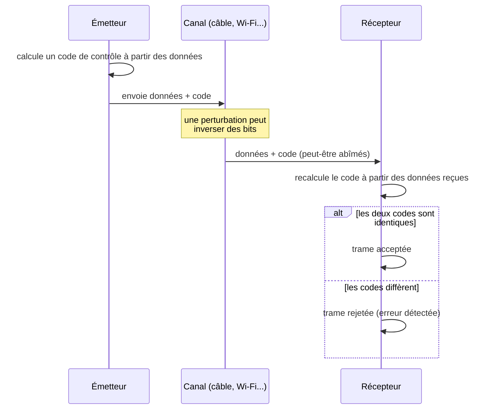
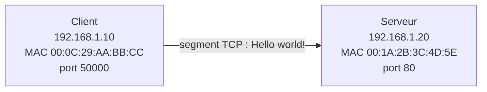
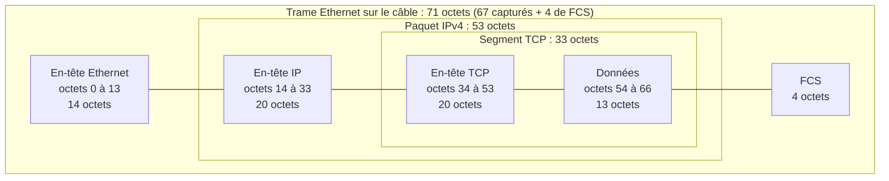
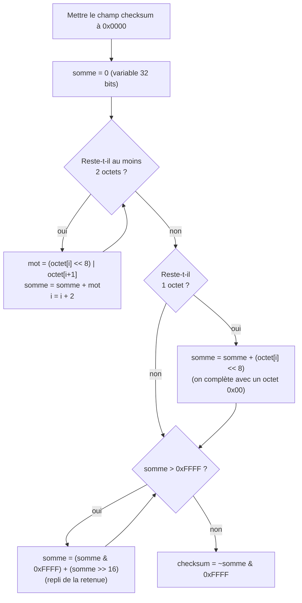
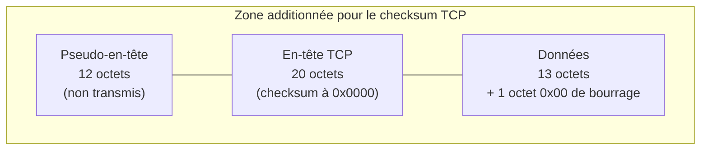
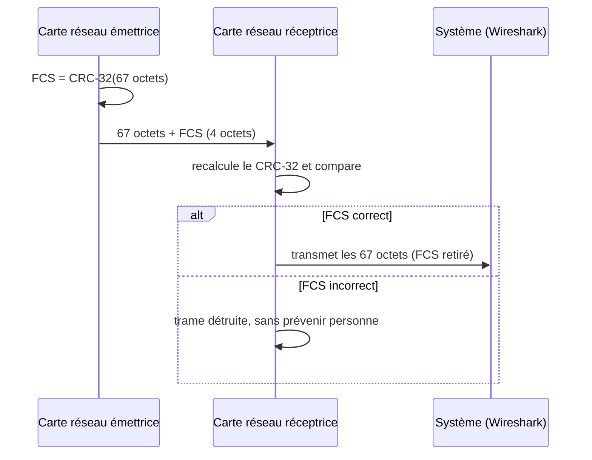
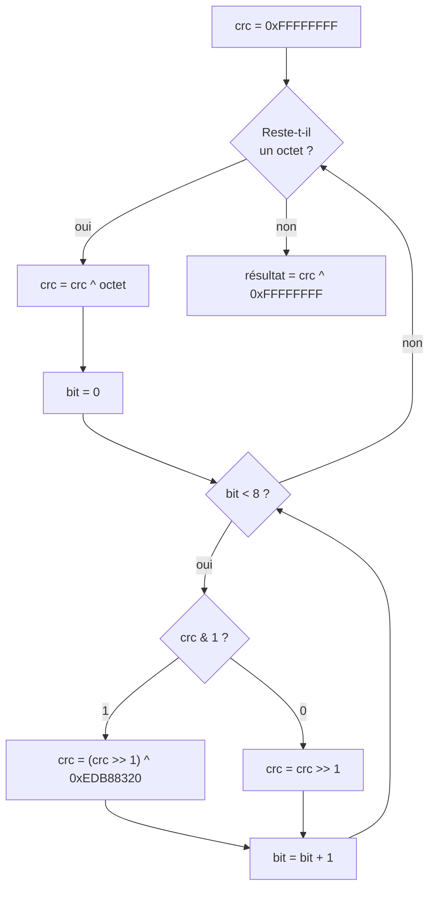

# Analyse de trames Ethernet / IP / TCP en langage C

**Public :** BTS CIEL (Cybersécurité, Informatique et réseaux, Électronique)
**Prérequis :** tableaux, boucles, opérateurs binaires (`&`, `|`, `^`, `<<`, `>>`), `uint8_t` / `uint16_t` / `uint32_t`, notions de modèle OSI

## Compétences visées

À la fin de ces exercices, vous saurez :

- **lire** une trame Ethernet octet par octet et retrouver chaque champ (adresses, ports, longueurs) ;
- **expliquer** comment un récepteur détecte qu'une trame a été abîmée pendant le transport ;
- **programmer** en C les deux grandes familles de codes de contrôle : le *checksum* et le *CRC* ;
- **vérifier** vos résultats avec un outil professionnel : Wireshark.

## Le problème : les erreurs de transmission

Sur un câble, une fibre ou en Wi-Fi, les bits sont transportés par un signal
électrique, lumineux ou radio. Une perturbation (moteur électrique, câble abîmé,
interférence) peut **inverser un ou plusieurs bits** : un `0` devient `1`.
Le récepteur n'a aucun moyen de le voir... sauf si l'émetteur a ajouté une
**information de contrôle**.

Le principe est toujours le même :



> Un code de contrôle **détecte** une erreur, il ne la **corrige** pas. Avec TCP,
> c'est l'émetteur qui renverra le segment perdu, faute d'acquittement.

## Plusieurs contrôles dans une même trame

Une trame réseau est construite par **encapsulation** : chaque couche du modèle
OSI ajoute son en-tête devant les données de la couche du dessus. Plusieurs couches
ajoutent leur propre code de contrôle :

| Couche | Protocole | Contrôle | Ce qui est protégé | Exercice |
|:------:|-----------|----------|--------------------|:--------:|
| 2 | Ethernet | **FCS** (CRC-32) | toute la trame | 2 |
| 3 | IPv4 | **Header Checksum** | l'en-tête IP seulement | 1 |
| 4 | TCP | **Checksum** | en-tête TCP + données (+ pseudo-en-tête) | 1 (suite) |

Vous allez programmer ces calculs en C sur une **vraie trame**, puis comparer vos
résultats avec ceux de Wireshark.

> **Rappel : ordre des octets.** Dans un en-tête réseau, les valeurs sur plusieurs
> octets sont en **big-endian** (octet de poids fort en premier, « ordre réseau »).
> Or votre PC est *little-endian*. Ne lisez donc jamais directement un `uint16_t`
> dans le tableau d'octets : reconstruisez-le vous-même.
>
> ```c
> uint16_t valeur = (uint16_t)((trame[i] << 8) | trame[i + 1]);
> ```

---

## La trame d'étude

### Le contexte

Un client (`192.168.1.10`) envoie le texte `"Hello world!\n"` (13 caractères,
retour à la ligne compris) à un serveur web (`192.168.1.20`, port 80).



La trame capturée fait **67 octets**. Elle ne contient pas le FCS : la carte réseau
le vérifie puis le retire avant de transmettre la trame au système, c'est pourquoi
Wireshark ne l'affiche pas.

Deux captures sont fournies dans le dossier :

- **`trame.pcap`** : la trame correcte ;
- **`trame_erreur.pcap`** : la même trame, dont un bit des données a été inversé.

### Les octets de la trame

```
00 1A 2B 3C 4D 5E 00 0C 29 AA BB CC 08 00 45 00
00 35 1C 46 40 00 40 06 9B 0E C0 A8 01 0A C0 A8
01 14 C3 50 00 50 00 00 10 00 00 00 20 00 50 18
10 00 AC C0 00 00 48 65 6C 6C 6F 20 77 6F 72 6C
64 21 0A
```

```c
const uint8_t trame[67] = {
    0x00, 0x1A, 0x2B, 0x3C, 0x4D, 0x5E, 0x00, 0x0C, 0x29, 0xAA, 0xBB, 0xCC, 0x08, 0x00, 0x45, 0x00,
    0x00, 0x35, 0x1C, 0x46, 0x40, 0x00, 0x40, 0x06, 0x9B, 0x0E, 0xC0, 0xA8, 0x01, 0x0A, 0xC0, 0xA8,
    0x01, 0x14, 0xC3, 0x50, 0x00, 0x50, 0x00, 0x00, 0x10, 0x00, 0x00, 0x00, 0x20, 0x00, 0x50, 0x18,
    0x10, 0x00, 0xAC, 0xC0, 0x00, 0x00, 0x48, 0x65, 0x6C, 0x6C, 0x6F, 0x20, 0x77, 0x6F, 0x72, 0x6C,
    0x64, 0x21, 0x0A
};
```

### Décodage de la trame

Les 67 octets se découpent en quatre blocs emboîtés, comme des poupées russes :



Pour s'y retrouver, chaque en-tête indique ce qu'il contient :

- l'**EtherType** `0x0800` de l'en-tête Ethernet annonce un paquet **IPv4** ;
- le champ **Protocole** `0x06` de l'en-tête IP annonce un segment **TCP** ;
- le **port destination** 80 de l'en-tête TCP désigne le service **HTTP**.

> **Méthode.** Prenez la trame en hexadécimal, un surligneur de chaque couleur,
> et délimitez chaque champ à l'aide des tableaux ci-dessous avant d'écrire le
> moindre code.

**En-tête Ethernet II** (octets 0 à 13, 14 octets)

| Offset | Taille | Champ | Valeur | Signification |
|:------:|:------:|-------|--------|---------------|
| 0 | 6 | MAC destination | `00:1A:2B:3C:4D:5E` | |
| 6 | 6 | MAC source | `00:0C:29:AA:BB:CC` | |
| 12 | 2 | EtherType | `0x0800` | le contenu est de l'IPv4 |

**En-tête IPv4** (octets 14 à 33, 20 octets)

| Offset | Taille | Champ | Valeur | Signification |
|:------:|:------:|-------|--------|---------------|
| 14 | 1 | Version / IHL | `0x45` | IPv4, en-tête de 5 × 4 = 20 octets |
| 15 | 1 | TOS | `0x00` | |
| 16 | 2 | Longueur totale | `0x0035` | 53 octets (IP + TCP + données) |
| 18 | 2 | Identification | `0x1C46` | |
| 20 | 2 | Flags / Fragment | `0x4000` | bit DF (ne pas fragmenter) |
| 22 | 1 | TTL | `0x40` | 64 |
| 23 | 1 | Protocole | `0x06` | TCP |
| 24 | 2 | **Header Checksum** | `0x9B0E` | à recalculer (exercice 1) |
| 26 | 4 | IP source | `C0 A8 01 0A` | 192.168.1.10 |
| 30 | 4 | IP destination | `C0 A8 01 14` | 192.168.1.20 |

**En-tête TCP** (octets 34 à 53, 20 octets)

| Offset | Taille | Champ | Valeur | Signification |
|:------:|:------:|-------|--------|---------------|
| 34 | 2 | Port source | `0xC350` | 50000 |
| 36 | 2 | Port destination | `0x0050` | 80 |
| 38 | 4 | Numéro de séquence | `0x00001000` | |
| 42 | 4 | Numéro d'acquittement | `0x00002000` | |
| 46 | 1 | Data offset | `0x50` | en-tête de 5 × 4 = 20 octets |
| 47 | 1 | Flags | `0x18` | PSH + ACK |
| 48 | 2 | Fenêtre | `0x1000` | 4096 |
| 50 | 2 | **Checksum TCP** | `0xACC0` | à recalculer (exercice 1, suite) |
| 52 | 2 | Pointeur urgent | `0x0000` | |

**Données** (octets 54 à 66) : `48 65 6C 6C 6F 20 77 6F 72 6C 64 21 0A` = « Hello world!\n »
(13 octets, nombre **impair** : voir le §1.2 pour le calcul du checksum).

---

## Exercice 1 : calcul du checksum IPv4 (puis TCP)

### 1.1 L'idée : additionner pour contrôler

Imaginez que vous envoyez par la poste une liste de nombres, et que vous écrivez
leur **total** en bas de la feuille. Le destinataire refait l'addition : si son
total diffère du vôtre, un nombre a été mal recopié. C'est exactement le principe
du **checksum** (« somme de contrôle »).

Le checksum d'Internet (RFC 1071), utilisé par IP, TCP, UDP et ICMP, applique cette
idée avec trois particularités :

- on additionne des **mots de 16 bits** (2 octets, en big-endian), pas des octets ;
- les retenues qui dépassent 16 bits ne sont pas perdues : elles sont **réinjectées**
  dans la somme (on parle d'addition « en complément à 1 ») ;
- on transmet l'**inverse** de la somme (`~somme`), ce qui simplifie la vérification.

### 1.2 L'algorithme pas à pas



**Mini-exemple avec deux mots seulement :** `0xF000` et `0x2001`.

| Étape | Calcul | Résultat |
|-------|--------|:--------:|
| Somme | `0xF000 + 0x2001` | `0x11001` (dépasse 16 bits) |
| Repli de la retenue | `0x1001 + 0x1` | `0x1002` |
| Complément à 1 | `~0x1002` | **`0xEFFD`** |

Le récepteur additionne **les données et le checksum reçu** :
`0xF000 + 0x2001 + 0xEFFD = 0x1FFFE`, repli : `0xFFFE + 0x1 = 0xFFFF`,
complément : `~0xFFFF = 0x0000`.

> **À retenir.**
> - **À l'émission**, le champ checksum vaut `0x0000` pendant le calcul, puis on y écrit le résultat.
> - **À la réception**, on calcule sur la zone **avec** le checksum reçu :
>   on doit obtenir `0x0000`. Tout autre résultat signale une erreur.

> **Pourquoi `0x0000` à la réception ?** Ajouter un nombre et son complément à 1
> donne toujours `0xFFFF` (tous les bits à 1). Le complément de `0xFFFF` vaut `0x0000`.

### 1.3 Application : checksum de l'en-tête IPv4

Le checksum IP ne protège **que l'en-tête IP** : les 20 octets aux offsets 14 à 33.
Les données sont protégées par TCP (§1.4). Pendant le calcul, le champ checksum
(offsets 24-25) est remplacé par `0x0000`.

On découpe l'en-tête en 10 mots de 16 bits :

| Mots | Contenu | Valeur |
|------|---------|:------:|
| 1 | Version/IHL + TOS | `0x4500` |
| 2 | Longueur totale | `0x0035` |
| 3 | Identification | `0x1C46` |
| 4 | Flags + Fragment | `0x4000` |
| 5 | TTL + Protocole | `0x4006` |
| 6 | Checksum (à zéro) | `0x0000` |
| 7 | IP source (haut) | `0xC0A8` |
| 8 | IP source (bas) | `0x010A` |
| 9 | IP destination (haut) | `0xC0A8` |
| 10 | IP destination (bas) | `0x0114` |

Somme cumulée :

```
0x4500 + 0x0035 = 0x4535
       + 0x1C46 = 0x617B
       + 0x4000 = 0xA17B
       + 0x4006 = 0xE181
       + 0x0000 = 0xE181
       + 0xC0A8 = 0x1A229
       + 0x010A = 0x1A333
       + 0xC0A8 = 0x263DB
       + 0x0114 = 0x264EF
```

La somme dépasse 16 bits : le `2` de `0x264EF` est la retenue.

| Étape | Calcul | Résultat |
|-------|--------|:--------:|
| Repli de la retenue | `0x64EF + 0x2` | `0x64F1` |
| Complément à 1 | `~0x64F1 & 0xFFFF` | **`0x9B0E`** |

On retrouve bien la valeur présente dans la trame aux offsets 24-25 ✔

**Vérification côté récepteur.** Même calcul, mais avec `0x9B0E` à la place de `0x0000` :
`0x264EF + 0x9B0E = 0x2FFFD` → repli : `0xFFFD + 0x2 = 0xFFFF` → `~0xFFFF = 0x0000` ✔
L'en-tête IP est intact.

### 1.4 Application : checksum TCP

Le checksum TCP protège plus de choses que le checksum IP :



Le **pseudo-en-tête** n'existe pas dans la trame : l'émetteur et le récepteur le
reconstruisent chacun de leur côté à partir de l'en-tête IP. En l'incluant dans le
calcul, TCP vérifie que le segment est bien arrivé **à la bonne machine** et pour le
**bon protocole** : un segment livré à une mauvaise adresse IP sera rejeté.

Contenu du pseudo-en-tête :

| Contenu | Valeur |
|---------|:------:|
| IP source | `C0 A8 01 0A` |
| IP destination | `C0 A8 01 14` |
| Zéro | `0x00` |
| Protocole | `0x06` |
| Longueur TCP (en-tête + données) | `0x0021` (33) |

Mots à additionner (les données comptant 13 octets, on **ajoute un octet `0x00`** pour
former le dernier mot : `0A` devient `0A00`) :

```
Pseudo-en-tête : C0A8 010A C0A8 0114 0006 0021
En-tête TCP    : C350 0050 0000 1000 0000 2000 5018 1000 0000 0000
Données        : 4865 6C6C 6F20 776F 726C 6421 0A00
```

- Somme : `0x18395` (pseudo-en-tête) `+ 0x153B8` (en-tête TCP) `+ 0x27BED` (données) `= 0x5533A`
- Repli : `0x533A + 0x5 = 0x533F`
- Complément à 1 : `~0x533F = 0xACC0` → **checksum TCP = `0xACC0`** ✔

> L'octet de bourrage `0x00` n'est ajouté que pour le calcul : il n'est pas transmis
> et n'est pas compté dans la longueur TCP (`0x0021`).

### 1.5 Travail demandé

Avancez dans l'ordre : chaque question s'appuie sur la précédente.

1. Écrire `uint16_t checksum_internet(const uint8_t *donnees, size_t taille)`
   (algorithme du §1.2, gère une taille impaire). Testez-la d'abord sur le
   mini-exemple `F0 00 20 01` : vous devez obtenir `0xEFFD`.
2. Écrire `int verifier_checksum_ip(const uint8_t *trame, size_t taille)` :
   - vérifie que `EtherType == 0x0800` et que la version IP vaut 4 ;
   - calcule la longueur de l'en-tête avec `IHL * 4` (ne supposez pas 20 octets) ;
   - retourne `1` si la somme de l'en-tête vaut `0x0000`, `0` sinon.
3. Dans `main()`, afficher les champs de la trame (adresses MAC, adresses IP en
   notation `a.b.c.d`, ports, flags TCP) puis tester la vérification du checksum IP
   sur la trame d'étude : résultat attendu `0x9B0E`.
4. Écrire `uint16_t checksum_tcp(const uint8_t *trame, size_t taille)` qui construit
   le pseudo-en-tête, puis calcule le checksum TCP. Résultat attendu : `0xACC0`.
   *Astuce : le plus simple est de copier pseudo-en-tête + segment TCP dans un
   tampon, en mettant le champ checksum à zéro.*
5. **Simuler des erreurs de transmission** et vérifier qu'elles sont détectées :
   - modifier 1 bit de l'adresse IP source (`trame[29] ^= 0x01;`) ;
   - modifier 1 octet des données (`trame[56] = 'X';`).
   Quel checksum détecte quelle erreur ? Pourquoi ?
6. **Pour aller plus loin :**
   - Écrire une fonction qui **forge** un en-tête IP : fixer le champ checksum à zéro,
     calculer, écrire le résultat dans la trame.
   - Changer le TTL de 64 à 63 (comme le ferait un routeur) et recalculer le
     checksum IP. Quelle est la nouvelle valeur ? (réponse : `0x9C0E`)
   - Quelle erreur ce checksum ne détecte-t-il pas ? (échanger deux mots de 16 bits.)

> **Pièges fréquents**
> - Accumuler la somme dans un `uint16_t` : les retenues sont perdues. Utilisez un `uint32_t`.
> - Lire les mots en little-endian : `0x4500` devient `0x0045` et tout est faux.
> - Oublier de remettre le champ checksum à `0x0000` avant le calcul à l'émission.
> - Pour TCP, compter l'octet de bourrage dans la longueur du pseudo-en-tête.

---

## Exercice 2 : calcul du FCS Ethernet (CRC-32)

### 2.1 Pourquoi un CRC ?

L'addition a un défaut : elle est **commutative**. `A + B` donne le même total que
`B + A`. Si deux mots de 16 bits sont échangés pendant le transport, le checksum ne
voit rien. De même, une erreur `+1` sur un mot et `-1` sur un autre se compensent.

Le **CRC** (*Cyclic Redundancy Check*, contrôle de redondance cyclique) remplace
l'addition par une **division** : la trame est vue comme un très grand nombre
binaire, que l'on divise par un nombre fixé à l'avance, le **polynôme générateur**.
Le **reste** de cette division est le code de contrôle. Changer un seul bit, ou
la position d'un octet, modifie complètement le reste.

| | Checksum Internet | CRC-32 Ethernet |
|---|---|---|
| Opération | addition | division (avec des XOR) |
| Taille du code | 16 bits | 32 bits |
| Erreur sur 1 bit | détectée | détectée |
| Permutation de deux mots | **non détectée** | détectée |
| Rafale d'erreurs ≤ 32 bits | pas toujours | **toujours détectée** |
| Coût de calcul | très faible | plus élevé (fait par la carte réseau) |

### 2.2 La division CRC à la main

Dans une division CRC, la soustraction est remplacée par un **XOR** (ou exclusif),
sans retenue : `0⊕0 = 0`, `0⊕1 = 1`, `1⊕0 = 1`, `1⊕1 = 0`.

Prenons un exemple réduit : un **CRC sur 3 bits**, avec le polynôme générateur
`1011` (x³ + x + 1), appliqué au message `110101`.

1. On ajoute à droite du message **autant de zéros que la taille du CRC** (3) : `110101 000`.
2. On place le polynôme sous le premier bit à `1` et on fait un XOR.
3. On recommence au bit à `1` suivant, jusqu'à ce qu'il ne reste que 3 bits.

```
110101000     message suivi de 3 zéros
1011          XOR
----
011001000
 1011         XOR (aligné sous le 1er bit à 1)
 ----
 01111000
  1011        XOR
  ----
  0100000
   1011       XOR
   ----
   001100
     1011     XOR
     ----
     0111     il reste 3 bits : CRC = 111
```

L'émetteur transmet le message **suivi du CRC** : `110101 111`.

Le récepteur divise ce qu'il a reçu par le même polynôme. Si la transmission
est correcte, le reste vaut `000`. Faites l'essai en inversant un bit du message :
le reste n'est plus nul.

Le CRC-32 d'Ethernet fonctionne exactement de la même façon, avec un polynôme de
33 bits (`0x104C11DB7`) et un reste de 32 bits.

### 2.3 Le FCS dans une trame Ethernet

Le **FCS** (*Frame Check Sequence*, 4 octets) est le CRC-32 de la trame. Il est
calculé par la carte réseau de l'émetteur et placé **à la fin** de la trame. Il protège
**de la MAC destination jusqu'à la fin des données** (le préambule n'est pas compris).



### 2.4 Paramètres du CRC-32 Ethernet

Un CRC n'est pas défini par son seul polynôme. Quatre autres paramètres doivent
être respectés à la lettre, sinon le résultat sera différent :

| Paramètre | Valeur |
|-----------|--------|
| Taille | 32 bits |
| Polynôme | `0x04C11DB7` |
| Polynôme « réfléchi » (utilisé dans le code) | `0xEDB88320` |
| Valeur initiale | `0xFFFFFFFF` |
| Sens de traitement des bits | poids faible en premier |
| XOR final | `0xFFFFFFFF` |

Le FCS est transmis **octet de poids faible en premier**.

> **Pourquoi un polynôme « réfléchi » ?** Ethernet émet les bits de chaque octet
> en commençant par le bit de poids faible. Pour traiter les bits dans ce même ordre,
> le code décale le CRC **vers la droite** et utilise le polynôme écrit à l'envers
> (`0x04C11DB7` lu de droite à gauche donne `0xEDB88320`).

### 2.5 Algorithme (bit à bit)

C'est la division du §2.2, programmée octet par octet : on fait entrer un octet
dans le registre `crc`, puis on traite ses 8 bits un par un.



Sous forme de pseudo-code :

```
crc = 0xFFFFFFFF
pour chaque octet de la trame :
    crc = crc XOR octet
    répéter 8 fois :
        si le bit de poids faible de crc vaut 1 :
            crc = (crc décalé d'1 bit vers la droite) XOR 0xEDB88320
        sinon :
            crc = crc décalé d'1 bit vers la droite
retourner crc XOR 0xFFFFFFFF
```

**Squelette en C :**

```c
uint32_t calcul_crc32(const uint8_t *donnees, size_t taille)
{
    uint32_t crc = 0xFFFFFFFF;

    for (size_t i = 0; i < taille; i++) {
        crc ^= donnees[i];
        for (int bit = 0; bit < 8; bit++) {
            if (crc & 1) {
                crc = (crc >> 1) ^ 0xEDB88320;
            } else {
                crc >>= 1;
            }
        }
    }
    return crc ^ 0xFFFFFFFF;
}
```

### 2.6 Jeux de test

**Test 1 : valeur de référence du CRC-32**
Données ASCII `"123456789"` (`31 32 33 34 35 36 37 38 39`) → CRC attendu : **`0xCBF43926`**.

**Test 2 : FCS de la trame d'étude**
CRC-32 des 67 octets de la trame → **`0xDB88FFBF`**.
Sur le câble, le FCS est transmis poids faible en premier :

```
... 6F 72 6C 64 21 0A | BF FF 88 DB
                       └── FCS ──┘
```

La trame complète fait donc 71 octets (67 + 4).

> Propriété utile : si l'on calcule le CRC-32 sur la trame **complète** (FCS compris,
> poids faible en premier), on obtient la constante `0x2144DF1C` quand la trame est
> correcte. Le récepteur peut donc vérifier sans extraire le FCS.

### 2.7 Travail demandé

1. **À la main d'abord.** Avec le polynôme `1011` du §2.2, calculer le CRC du message
   `100100` (réponse : `101`). Vérifier ensuite que la division de `100100 101` donne
   un reste nul.
2. Écrire `uint32_t calcul_crc32(const uint8_t *donnees, size_t taille)`.
3. Valider avec le test 1 (`0xCBF43926`) puis avec le test 2 (`0xDB88FFBF`).
4. Écrire `void ajouter_fcs(uint8_t *trame, size_t taille_sans_fcs)` qui ajoute le FCS
   à la fin de la trame, dans le bon ordre d'octets.
5. Écrire `int verifier_fcs(const uint8_t *trame, size_t taille)` qui recalcule le CRC
   sur `taille - 4` octets et le compare aux 4 derniers octets.
6. Simuler des erreurs sur la trame de 71 octets et vérifier la détection :
   - inverser 1 bit ;
   - **permuter deux mots de 16 bits** de l'en-tête IP. Le checksum IP le détecte-t-il ?
     Le FCS le détecte-t-il ? Relier votre réponse au tableau du §2.1.
7. **Trame trop courte :** Ethernet impose une taille minimale de 64 octets (FCS compris).
   Une trame ARP de 42 octets doit être complétée par 18 octets de bourrage (*padding*)
   à zéro avant le calcul du FCS. Construire une telle trame et calculer son FCS.
8. **Pour aller plus loin :**
   - Écrire une version **par table** (256 valeurs `uint32_t` précalculées) et
     comparer la rapidité avec la version bit à bit sur un grand tampon.
   - Écrire un programme qui lit une capture `.pcap` ou un export hexadécimal de
     Wireshark et vérifie les checksums de chaque trame.

> **Pièges fréquents**
> - Utiliser un `int` signé pour `crc` : le décalage à droite propage le bit de signe. Utilisez un `uint32_t`.
> - Oublier la valeur initiale `0xFFFFFFFF` ou le XOR final : le test `"123456789"` échoue.
> - Écrire le FCS en big-endian : sur le câble, c'est l'octet de poids **faible** qui part en premier.
> - Inclure le FCS dans le calcul de `verifier_fcs` (sauf si vous utilisez la constante `0x2144DF1C`).

---

## Vérification avec Wireshark

1. Ouvrir `trame.pcap` (*Fichier → Ouvrir*, ou `wireshark trame.pcap`). Ouvrir ensuite
   `trame_erreur.pcap` pour comparer. Les deux captures contiennent un seul paquet,
   **sans FCS** (Wireshark ne le voit pas, la carte réseau l'ayant déjà retiré) :
   l'exercice 2 se vérifie donc avec votre programme et la valeur `0xDB88FFBF`.
2. Dans *Édition → Préférences → Protocols → IPv4* et *TCP*, activer
   **« Validate the checksum if possible »**.
3. Wireshark affiche `[correct]` ou `[incorrect]` à côté de chaque checksum.
   Modifier un octet du fichier pour observer l'erreur.

## Documents de référence (dossier `rfc/`)

| Fichier | Titre | À consulter pour |
|---------|-------|------------------|
| `rfc/rfc791.txt` | Internet Protocol (IPv4) | format de l'en-tête IP, champ *Header Checksum* (§3.1) |
| `rfc/rfc793.txt` | Transmission Control Protocol | format de l'en-tête TCP, checksum et pseudo-en-tête (§3.1) |
| `rfc/rfc894.txt` | IP sur Ethernet | encapsulation IP dans une trame Ethernet II (EtherType `0x0800`) |
| `rfc/rfc1071.txt` | Computing the Internet Checksum | algorithme de la somme en complément à 1 (exercice 1) |
| `rfc/rfc1624.txt` | Incremental Internet Checksum | mise à jour du checksum après modification d'un champ (TTL) |

Le CRC-32 du FCS Ethernet n'est pas défini par un RFC mais par la norme IEEE 802.3.

## Rendu attendu

- Un fichier source par exercice : `checksum_ip.c` et `crc32_eth.c`.
- Chaque fonction est commentée (rôle, paramètres, valeur de retour).
- Le programme affiche les octets en hexadécimal (`printf("%02X ", octet);`) et
  indique clairement « checksum correct » / « trame invalide ».
- Compilation sans avertissement :

```bash
gcc -Wall -Wextra -o checksum_ip checksum_ip.c
gcc -Wall -Wextra -o crc32_eth crc32_eth.c
```

## Barème indicatif

| Critère | Points |
|---------|:------:|
| Décodage des champs de la trame (MAC, IP, ports, flags) | 3 |
| `checksum_internet` correct (IP → `0x9B0E`) | 4 |
| `checksum_tcp` avec pseudo-en-tête (→ `0xACC0`) | 3 |
| `calcul_crc32` correct (`0xCBF43926` et `0xDB88FFBF`) | 5 |
| Vérification / ajout du FCS (ordre des octets) | 2 |
| Tests d'erreurs simulées et analyse | 2 |
| Qualité du code (noms, commentaires, compilation sans warning) | 1 |
